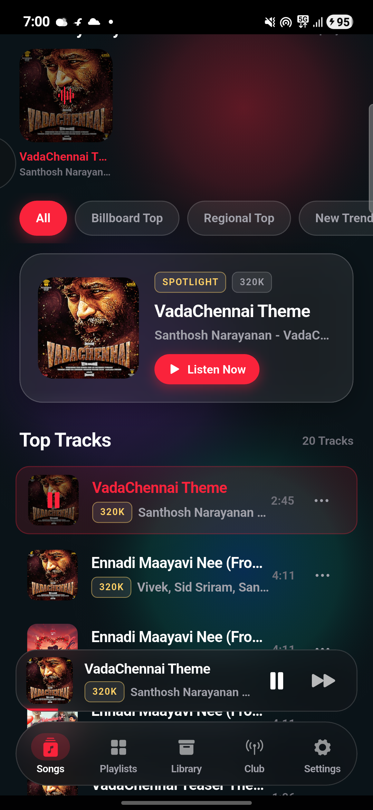

# Hearable

> An ad-free, high-fidelity music streaming Android application featuring an Apple Music frosted-glass (glassmorphic) UI, native hardware audio tuning (320kbps punchy bass & spatial stereo), and a local Wi-Fi synchronized multi-device party playback engine ("Club").



---

## Features

- **Apple Music Frosted-Glass UI**: Full-bleed edge-to-edge Obsidian AMOLED glassmorphic interface with dynamic ambient album art glow (`BackdropFilter` sigma 25–35).
- **High-Fidelity Audio (320kbps Master)**: Native audio pipeline streaming 320kbps audio with flat, bit-perfect fidelity and optional 5-band graphic equalizer.
- **Time-Synced Karaoke Lyrics**: Smooth spring-scrolling active verse enlargement powered by JioSaavn lyrics API with LRCLIB fallback.
- **Real-Time Debounced Search**: 350ms asynchronous debouncing with live suggestion chips for zero API spamming.
- **Dynamic Home Feed**: Horizontal sliding showcase cards ("Billboard Hot 100", "Regional Top Hits", "Viral New Trends") and a horizontal "Recently Played" shelf.
- **Club Party Mode**: Ultra-low latency multi-device synchronized playback over local Wi-Fi with host WebSocket server and automatic client clock offset syncing.
- **Spotify Playlist Importer**: One-click import of public Spotify playlists with automatic track matching.
- **Background Playback & Lock-Screen Controls**: Powered by `just_audio_background` with full lock-screen metadata and notification action support.

---

## 1-Click Windows ADB Installer

For Windows users installing releases directly to an Android phone or emulator:

1. Connect your Android device via USB and enable **USB Debugging**.
2. Run `installer\install_hearable.bat`.
3. The script automatically detects connected devices and installs the APK with a single click.

---

## Building from Source

```bash
# Clone the repository
git clone https://github.com/joo6612/Hearable.git
cd Hearable

# Get Flutter dependencies
flutter pub get

# Build the release APK
flutter build apk --release
```

---

## License

Built with Flutter for Android (SDK 24 to 34+).
